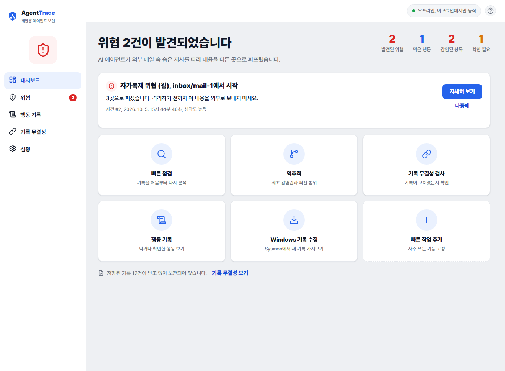

# AgentTrace

내 PC의 AI 에이전트가 위험한 행동을 하기 전에 잡고(탐지, 차단), 이미 퍼진 공격은 최초
감염원과 감염 범위까지 거슬러 올라가는(역추적) **개인용 로컬 보안 도구**의 시제품.

판정은 규칙, 지문, 그래프가 하고 LLM은 설명만, **네트워크, LLM 없이 동작**합니다.

**일반 사용자**: [Releases](https://github.com/55wind/agenttrace/releases)에서 받아 더블클릭 (Python 불필요).
- `AgentTrace-v0.1.1-win.zip` 권장: 압축을 풀고 "데모로 실행.bat" 을 더블클릭하면 예시 화면이 채워진 상태로 열립니다. 실제 사용은 `AgentTrace.exe` 더블클릭.
- `AgentTrace.exe` 단독: 처음에는 기록이 비어 "안전합니다" 상태로 시작합니다.

**개발자**:
```bash
pip install -r requirements.txt
python demo.py                                # 시나리오 S1~S5 재현
python -m pytest                              # 자체 테스트 16종
python -m agenttrace.dashboard agenttrace.db  # 대시보드 http://127.0.0.1:8787
```



- 기획 배경: [`에이전트_탐지_역추적_통합제안서.md`](에이전트_탐지_역추적_통합제안서.md)
- 사용 방법: [`docs/사용방법.md`](docs/사용방법.md)
- 기능 명세: [`docs/기능명세서.md`](docs/기능명세서.md)
- 실측 성능: [`docs/실측치.md`](docs/실측치.md) (관문 판정 지연 평균 약 0.08 ms, 실측)
- 실제 동작 테스트(VM): [`vmtest/README.md`](vmtest/README.md)

## 실제 동작 확인

```bash
python vmtest/detection_selftest.py   # 관문 차단, 웜 탐지, 역추적을 실제로 검증
```

위험 명령이 실제 실행 전에 막히는지(표식 파일 미생성), 실제 파일 흐름에서 웜 복제를
탐지하고 감염원까지 역추적하는지 확인합니다. Sysmon 상시 수집과 실제 에이전트
(Claude Code) 훅 연동은 VM에서 [`vmtest/README.md`](vmtest/README.md)를 따라 확인하세요.

## 구조

```
agenttrace/
  store.py        SQLite + 해시 체인 저장소 (변조 방지)
  fingerprint.py  정규화, SHA-256 지문, 유사도, 지시문 점수
  guard.py        실행 전 관문 (allow/ask/block)
  policy.yaml     판정 규칙
  engine.py       오염 추적, 복제 탐지 (Monitor)
  trace.py        전파 그래프, 역추적 (stdlib BFS)
  app.py          데스크톱 창 GUI 런처 (pywebview, 브라우저 폴백)
  monitor_app.py  상시 감시 트레이 앱 (Sysmon 루프, 자동 실행)
  autostart.py    Windows 시작 시 자동 실행 등록 (winreg)
  report.py       근거 기반 4단 보고
  collector.py    Sysmon 로그 수집 (wevtutil, ID 1, 3, 11, 13)
  embedding.py    변형 웜 보완 유사도 (임베딩 선택, stdlib 폴백)
  mcp_server.py   읽기 전용 MCP 서버 (공식 mcp SDK, stdio, 도구 4종)
  dashboard.py    로컬 웹 대시보드 (stdlib 웹서버, 오프라인)
demo.py           S1~S5 end-to-end
tests/            자체 테스트
```
